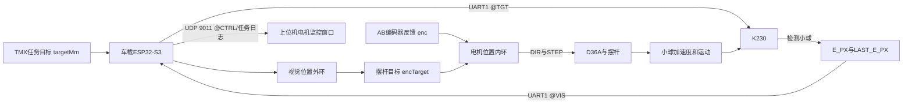

# ESP32-S3 车载平衡滚球集中处理器

本工程使用 ESP32-S3 N16R8、ESP-IDF 5.4.3 和 FreeRTOS，负责接收任务目标与 K230 视觉反馈，在车载端完成小球位置外环和摆杆编码器位置内环，并通过 Wi-Fi UDP 向上位机输出调参遥测。

## 1. 系统数据流



系统包含两套不同坐标：

| 坐标 | 单位 | 含义 |
|---|---:|---|
| `targetMm` | mm | 小球在摆杆上的目标位置，中心点 O 为 0 |
| `E_PX` | px | 小球当前像素位置与目标像素位置之差 |
| `balance` | count | 摆杆水平时的电机 A/B 编码器位置 |
| `encTarget` | count | 视觉外环计算出的电机目标位置 |
| `enc` | count | 电机 A/B 编码器实际位置 |

电机count无需先转为角度也可组成位置闭环；若需要杆角模型或杆角限幅，仍需标定电机连杆映射。4096 count/rev的诊断换算只表示编码器轴角，详见根目录两份分析报告。

## 2. 硬件接口

### WS2812补光灯

| ESP32-S3 | 8灯WS2812模块 | 说明 |
|---:|---:|---|
| GPIO21 | DIN | RMT发送WS2812的GRB数据 |
| 外部5V | 5V | 不得使用GPIO给灯珠供电 |
| GND | GND | ESP32与补光灯电源必须共地 |

补光灯在ESP32启动时点亮为白光，默认RGB三个通道均为`64/255`。
数据线没有串联电阻时应尽量短（建议不超过20cm），接好线后再上电，
避免带电插拔。8颗全白灯应使用至少1A的5V电源；若出现乱闪或颜色错误，
再增加`220~470Ω`数据串联电阻或使用`74AHCT125`电平转换。

### D36A

| ESP32-S3 | D36A | 说明 |
|---:|---|---|
| GPIO18 | ST1/STEP | 步进脉冲 |
| GPIO8 | DIR1 | 方向 |
| GPIO3 | EN1 | 高电平使能 |
| GND | GND | 必须共地 |

方向已经标定：

```text
DIR=HIGH -> 向车头转，A/B计数增加
DIR=LOW  -> 向车尾转，A/B计数减少
```

### MS42CG编码器

| ESP32-S3 | 编码器 | 说明 |
|---:|---|---|
| GPIO4 | A | 正交增量输入 |
| GPIO5 | B | 正交增量输入 |
| GPIO6 | PWM | 单圈绝对角度 |
| GPIO7 | Z | 每圈索引脉冲 |
| 3.3V | VCC | 编码器供电 |
| GND | GND | 共地 |

A/B按 `4096 count/rev` 使用。当前实时位置内环使用 A/B；PWM绝对角度用于记录和检查平衡零点；Z用于诊断。

### TMX UART

| ESP32-S3 | TMX | 说明 |
|---:|---|---|
| GPIO11/RX | PA10/TX | TMX向ESP32单向发送任务日志 |
| GND | GND | 共地 |

GPIO12已释放，ESP32不向TMX回传数据。串口格式为115200-8N1。

### K230视觉UART

| K230 | ESP32-S3 | 说明 |
|---:|---:|---|
| IO9/UART1_TX | GPIO46/UART1_RX | K230发送`@VIS` |
| IO10/UART1_RX | GPIO13/UART1_TX | ESP32发送`@TGT` |
| GND | GND | 必须共地 |

使用3.3V TTL和115200-8N1。GPIO46只作为ESP32输入使用；视觉UART与
TMX的UART2/GPIO11互不冲突。

### JY901S I2C

| ESP32-S3 | JY901S | 说明 |
|---:|---|---|
| GPIO16/SDA | SDA | I2C数据线 |
| GPIO15/SCL | SCL | I2C时钟线 |
| 3.3V | VCC | 按模块供电要求连接 |
| GND | GND | 必须共地 |

JY901S使用I2C0、100kHz和7位地址`0x50`。ESP32每20ms从
`AX=0x34`开始连续读取XYZ三个16位寄存器。当前安装中X轴为小车纵向轴，
前进加速为正；X轴先执行分母为4的一阶低通，再扣除静止零偏`+15mg`：

```text
aLongMg = filteredAxMg - 15
```

三轴原始换算值、纵向动态加速度和T4动态前馈均追加到`@CTRL`：

```text
imu=<fresh> imuAge=<ms> imuSeq=<count> ax=<mg> ay=<mg> az=<mg>
aLong=<mg> aff=<count>
```

T4将固定起步前馈与X轴动态前馈相加。动态前馈使用`aLong*2/5`、
`12mg`死区、`±30 count`限幅和每10ms最多`4 count`的渐变；Y/Z轴不参与控制。
IMU超过200ms未更新时，动态前馈按同一渐变速度退回0。

## 3. 任务输入与独立参数

### TEST模式

TEST 是独立诊断页，不启用滚球闭环。进入 TEST 后 ESP32 停止 STEP 脉冲、复位视觉外环并取消 D36A 使能，摆杆由机构自由停靠，也不向 K230 下发新的目标位置。

TEST期间D36A保持取消使能，ESP32每20ms上报一条独立测试遥测：

```text
@TEST ... epx=<钢球位置误差px> v=<钢球速度px/s> ...
      ax=<X轴mg> ay=<Y轴mg> az=<Z轴mg> aLong=<纵向动态加速度mg>
```

`vis/age`用于判断视觉数据是否有效，`imu/imuAge/imuErr`用于判断
JY901S I2C数据是否有效。

TMX只负责单向上报，ESP32按 `source + eventSeq + type + run` 对任务事件去重，重复日志仍原样转发到上位机。`source`缺省时按TMX处理，显式非TMX来源不会进入车载任务状态机。

每个任务拥有独立参数槽，修改一个任务不会覆盖其他任务。参数可放在三种协议行中：

```text
@PARAM source=TMX task=T3 targetMm=... target2Mm=... timeoutMs=...
@MODE source=TMX eventSeq=... type=ENTER mode=PREP task=T3 targetMm=...
@TASK source=TMX eventSeq=... type=TASK_BEGIN run=... task=T3 targetMm=...
```

进入准备页时加载该任务参数；`TASK_BEGIN`再次生成运行快照，运行中的参数不会被其他任务覆盖。支持字段如下：

| 字段 | 作用 |
|---|---|
| `targetMm` | 第一目标位置；兼容 `target_mm` 和 `target` |
| `target2Mm` | T3第二目标位置；兼容 `secondaryTargetMm` |
| `timeoutMs` | 通用任务参数；T3不以超时结束，只等待终点稳定 |
| `reachPx` | T3第一目标停稳门限；13 px约束会在PREP/BEGIN默认参数路径被覆盖，默认实际为27 px |
| `reachFrames` | 第一目标连续满足条件的有效新视觉帧数，默认2 |
| `reachSpeed` | 第一目标速度门限，默认50 px/s |
| `settlePx` | T3第二目标稳定门限；默认启动路径实际为27 px，不能保证13 px |
| `settleSpeed` | T3第二目标稳定速度门槛 |
| `settleFrames` | T3第二目标连续稳定帧数 |
| `captureFrames` | T6准备页参考位置采样帧数 |

参数生效时ESP32通过UDP 9011发送 `@PARAM source=ESP32 task=... state=...`，其中包含该任务的完整参数快照。目标变化时立即通过UART向K230发送 `@TGT`，目标不变时也会每秒重发。

## 4. K230视觉反馈

K230将 `targetMm` 通过标定表换算为目标像素坐标，并计算：

```text
E_PX = BALL_X - TARGET_X
```

因此：

```text
E_PX < 0 -> 小球位于目标左侧
E_PX > 0 -> 小球位于目标右侧
E_PX = 0 -> 小球位于目标位置
```

K230传统CV程序通过UART1发送：

```text
@VIS,VALID,E_PX,LAST_E_PX,V_PX_S\r\n
```

示例：

```text
@VIS,1,-120,-120,350\r\n
```

`VALID=1`表示当前帧检测到小球；`VALID=0`时 `E_PX` 固定为 0，`LAST_E_PX`保留最后一次有效误差。`V_PX_S`是K230在640坐标系中估算的横向速度，右正左负；短时丢检时仅用于状态预测。

## 5. 平衡零点

首次进入任一滚球任务的PREP（T3至T6）时：

1. ESP32将STEP置低并使能D36A。
2. 至少等待1秒，让使能后的机械机构完成初步运动。
3. 要求A/B编码器连续稳定300 ms。
4. 记录当前A/B计数为 `balance`。
5. 记录当前PWM单圈角度为 `balancePwmMd`。

同一次开机期间会保留该平衡零点。TEST 页不建立、也不刷新平衡零点。

ESP32重启后没有持久化平衡零点，首次记录前必须保证摆杆处于实际水平位置。

## 6. 小球速度输入

K230在视觉帧中直接发送其Alpha-Beta状态估计器输出的 `V_PX_S`。ESP32不再根据整数像素误差和串口帧到达间隔重复求导，传输调度抖动不会进入速度估计。

`vPxS`单位为像素每秒：

```text
vPxS > 0 -> 小球向画面右侧运动
vPxS < 0 -> 小球向画面左侧运动
```

ESP32只对参与停车预测的速度进行限幅，避免异常速度产生过大的预测距离；不再对K230速度二次滤波。

## 7. 五阶段视觉位置外环

外环不再输出容易落入机械无效区的小角度，也不再使用积分慢慢堆到启动角。每轮调整只使用实测可带动小球的固定角度：

```text
HOLD
  -> DRIVE：向目标保持 thetaStart
  -> BRAKE：反向保持 thetaBrake
  -> DAMP：按速度方向施加小幅反向阻尼
  -> SETTLE：回平并检查位置、速度
  -> HOLD 或再次 DRIVE
```

DRIVE和BRAKE角度分别由 `MOTOR_DRIVE_OFFSET_COUNT`、`MOTOR_BRAKE_OFFSET_COUNT` 定义。DAMP不使用固定大角度，而是根据K230速度计算与运动方向相反的小角度并限制最大幅度。DRIVE方向固定为：

```text
dampOffsetCount = clamp(-vControl / velocityDivisor,
                        -dampMaxOffset, +dampMaxOffset)
```

```text
E_PX < 0 -> offsetCount=+thetaStart -> 向车头转
E_PX > 0 -> offsetCount=-thetaStart -> 向车尾转
```

DRIVE期间使用预测停车误差决定反向制动时刻：

```text
vControl = clamp(vPxS, -velocityLimit, +velocityLimit)
angleDelayPx = vControl * responseTime
brakePx = vControl * |vControl| / (2 * brakeAcceleration)
stopErrorPx = E_PX + angleDelayPx + brakePx
```

DRIVE阶段使用BRAKE响应时间预测制动开始真正产生效果前的位移；BRAKE阶段使用较短的回平响应时间预测回平动作真正完成前的速度变化。只有编码器实际到达DRIVE目标角后，才允许根据 `stopErrorPx` 切换BRAKE，阶段计时也从此刻开始。

各阶段切换条件：

| 阶段 | 摆杆目标 | 切换条件 |
|---|---:|---|
| `HOLD` | 平衡位置 | 连续若干新视觉帧超过DRIVE启动误差后进入DRIVE |
| `DRIVE` | 沿纠偏方向保持 `thetaStart` | 实际到角且预测停车误差进入制动裕量后进入BRAKE |
| `BRAKE` | DRIVE反方向保持 `thetaBrake` | 摆杆进入BRAKE方向，K230速度相对BRAKE峰值明确下降，且计入回平响应后的预测速度进入门槛后进入DAMP |
| `DAMP` | 从BRAKE实际角度逐帧逼近与钢球速度方向相反的小幅动态角度 | 摆杆接近水平，且钢球速度和位置连续稳定达到规定帧数与时长后进入SETTLE |
| `SETTLE` | 平衡位置 | 限速回平并连续满足低速条件后，根据位置误差进入HOLD；再次DRIVE仍需满足连续帧启动条件 |

HOLD误差与DRIVE启动误差形成位置滞回区，避免在边界反复切换。所有角度目标最终受最大偏转参数限制。

DRIVE目标角首次实际到位后开始独立记录总运行时间和最佳位置误差。进展窗口内误差改善不足时只允许提升一次启动角；升角会重新等待目标角到位，但不会重置总超时。仍无进展或触发硬超时后立即进入SETTLE回平并锁存故障，本次运行不再自动启动DRIVE。

控制参数的具体值只在 `components/App/app_motor_control/app_motor_control.c` 中维护：

| 参数宏 | 作用 |
|---|---|
| `MOTOR_DRIVE_OFFSET_COUNT` | DRIVE阶段相对平衡位置的固定角度 |
| `MOTOR_DRIVE_PROGRESS_WINDOW_MS` | DRIVE检查位置是否产生有效进展的观察窗口 |
| `MOTOR_DRIVE_MIN_PROGRESS_PX` | DRIVE观察窗口内要求达到的最小误差改善量 |
| `MOTOR_DRIVE_HARD_TIMEOUT_MS` | 从首次DRIVE到角开始计算且不会被升角重置的总超时 |
| `MOTOR_DRIVE_BOOST_OFFSET_COUNT` | 首次无进展时启用的单级提升角度 |
| `MOTOR_DRIVE_MAX_RECOVERY_OFFSET_COUNT` | 机械安全确认后预留的第二级恢复角，本轮不启用 |
| `MOTOR_BRAKE_OFFSET_COUNT` | BRAKE阶段相对平衡位置的反向固定角度 |
| `MOTOR_DAMP_VELOCITY_DIVISOR` | 将K230速度换算为DAMP小角度的比例因子 |
| `MOTOR_DAMP_MAX_OFFSET_COUNT` | DAMP相对平衡位置允许的最大角度 |
| `MOTOR_DAMP_SETTLE_SPEED_PX_S` | DAMP进入SETTLE的低速门槛 |
| `MOTOR_DAMP_STABLE_FRAMES` | DAMP进入SETTLE所需的连续稳定视觉帧数 |
| `MOTOR_DAMP_POSITION_STABLE_PX` | DAMP稳定窗口内允许的钢球位置变化范围 |
| `MOTOR_DAMP_MIN_STABLE_MS` | DAMP进入SETTLE前必须持续满足联合稳定条件的最短时间 |
| `MOTOR_DAMP_STEP_MAX_FREQUENCY_HZ` | DAMP和SETTLE回程使用的STEP频率上限 |
| `MOTOR_DRIVE_START_ERROR_PX` | HOLD进入DRIVE的误差门槛，也是位置滞回上边界 |
| `MOTOR_DRIVE_START_STABLE_FRAMES` | HOLD或SETTLE进入DRIVE前要求连续超过误差门槛的视觉帧数 |
| `MOTOR_SETTLE_POSITION_PX` | SETTLE进入HOLD的位置门槛，也是位置滞回下边界 |
| `MOTOR_SETTLE_SPEED_PX_S` | SETTLE低速判断门槛 |
| `MOTOR_BRAKE_DAMP_SWITCH_SPEED_PX_S` | BRAKE切换DAMP时允许保留的预测朝目标速度门槛 |
| `MOTOR_BRAKE_SPEED_DROP_PX_S` | BRAKE确认速度相对峰值确实下降所需的最小速度差 |
| `MOTOR_BRAKE_SWITCH_MARGIN_PX` | DRIVE切换BRAKE的预测停车误差裕量 |
| `MOTOR_VISION_BRAKE_SPEED_LIMIT_PX_S` | 参与停车预测的速度限幅 |
| `MOTOR_VISION_BRAKE_ACCEL_PX_S2` | 停车距离模型中的等效制动能力 |
| `MOTOR_BRAKE_RESPONSE_MS` | DRIVE切换BRAKE后的制动响应时间 |
| `MOTOR_LEVEL_RESPONSE_MS` | BRAKE切换小角度DAMP后的近似回平响应时间 |
| `MOTOR_PHASE_ANGLE_TOLERANCE_COUNT` | 判定阶段目标角已到达的编码器容差 |
| `MOTOR_SETTLE_STABLE_FRAMES` | SETTLE满足低速条件所需的连续视觉帧数 |
| `MOTOR_MAX_OFFSET_COUNT` | 相对平衡位置允许的最大偏转 |

## 8. 编码器位置内环

内环计算：

```text
positionError = encTarget - enc
```

控制规则：

```text
positionError > positionTolerance  -> DIR=FRONT，输出STEP
positionError < -positionTolerance -> DIR=REAR，输出STEP
|positionError| <= positionTolerance -> 停止STEP并保持使能
```

位置误差超过容差时，内环按控制周期读取最新编码器位置，并按位置误差采用V型分档速度：

```text
stepHz = quantize(
    clamp(|positionError| * frequencyGain,
          minimumFrequency,
          maximumFrequency),
    frequencyQuantum)
```

误差越大，LEDC硬件STEP频率越高；误差收小时自动降速精调，到位后立即停止硬件脉冲并保持使能。FreeRTOS控制任务不用任务忙等生成脉冲。

内环参数同样只在控制模块中维护：

| 参数宏 | 作用 |
|---|---|
| `MOTOR_CONTROL_PERIOD_MS` | 电机控制任务周期 |
| `MOTOR_POSITION_TOLERANCE_COUNT` | 编码器位置内环到位容差 |
| `MOTOR_STEP_MIN_FREQUENCY_HZ` | STEP最低频率 |
| `MOTOR_STEP_MAX_FREQUENCY_HZ` | STEP最高频率 |
| `MOTOR_STEP_FREQUENCY_QUANTUM_HZ` | STEP频率分档粒度 |
| `MOTOR_STEP_FREQUENCY_GAIN_HZ_PER_COUNT` | 位置误差到STEP频率的比例增益 |
| `MOTOR_STEP_RAMP_INCREMENT_HZ` | DIR换向后每个控制周期允许增加的STEP频率 |

`netSteps`只记录累计命令方向，用于ESP32本地状态日志，不参与位置控制或限位。

## 9. 模式行为

### TEST

```text
进入TEST
  -> 停止STEP脉冲
  -> 复位视觉外环
  -> 取消D36A使能
  -> 每20ms输出一条@TEST诊断遥测
退出TEST
  -> 保持D36A取消使能
```

TEST 不建立平衡零点、不输出STEP、也不执行小球归中。摆杆目标角与位置状态由 T3 至 T6 的 PREP 入口建立，TEST 页不参与控制。

### T1至T6

| 任务 | ESP32调度阶段 | D36A行为 |
|---|---|---|
| T1 | `PREP -> BYPASS -> COMPLETE` | 录像开关测试，不使能滚球电机 |
| T2 | `PREP -> BYPASS -> COMPLETE` | 快速循迹，不使能滚球电机 |
| T3 | `PREP -> T3_POS -> T3_NEG -> COMPLETE/FAULT` | 静止执行第一目标到第二目标 |
| T4 | `PREP -> TRACK -> COMPLETE(HOLD_ZERO)` | 固定目标滚球闭环；底盘结束后继续保持O点 |
| T5 | `PREP -> TRACK -> COMPLETE` | 固定目标滚球闭环 |
| T6 | `PREP -> TRACK -> COMPLETE/FAULT` | 准备页采集并冻结任意位置参考 |

T3至T6进入PREP时提前使能D36A并建立或返回平衡零点。T3至T5准备页可以按当前任务目标归中；T6准备页只回平摆杆并采集钢球位置，不把钢球拉回中心。

T3采用电机计数到位驱动的分段轨迹。正向DRIVE为+36 count，到位后保持250 ms；TURN为+3 count，到位后保持50 ms；BRAKE为-clip(|v|/4,22,30) count，随后进入DAMP。返程使用当地零偏-10 count、DRIVE -46 count和BRAKE +20至+32 count，属于非对称控制。第一目标切换要求位置、速度、电机实际偏置均进入门限并连续满足reachFrames；默认启动路径的位置门限为27 px，13 px常量约束会被参数覆盖。返程低速停滞300 ms时允许最多3次起动/制动脉冲，幅度16、20、24 count；最终稳定还要求电机返回当地零点附近及持续至少300 ms。这里的到位判据测量电机count，并未独立测量真实杆角。

T6运行误差为：

```text
controlErrorPx = currentEpx - referencePx
```

只有有效稳定帧达到该任务的 `captureFrames` 后参考位置才有效；`TASK_BEGIN`冻结最后参考值，运行中不再改写。没有有效参考时进入 `FAULT` 并保持摆杆水平。

所有任务的底盘结束事件均由TMX发送。T3在ESP32内部到达第二目标后只标记完成并继续稳定控制，不自行伪造 `TASK_END`。T4收到TMX结束事件后进入 `COMPLETE(HOLD_ZERO)`，继续以 `0 mm` 为目标执行视觉与编码器双闭环，直到下一次进入PREP/TEST或开始新任务。其他任务结束后停止STEP并保持D36A使能锁定；T1/T2在准备和运行阶段均保持D36A关闭。

## 10. 视觉数据超时

- 当前检测或 `LAST_E_PX` 在 `MOTOR_VISION_CONTROL_FRESH_US` 定义的有效窗口内可以参与控制。
- T4只有`vis=1`的新帧才更新位置/速度反馈；`vis=0`时冻结最后一次反馈输出，X轴动态前馈继续更新。
- 其他任务超过有效窗口没有可用视觉位置时，`encTarget`回到 `balance`。
- 不会拿超过有效窗口的旧误差持续给小球加速度。

## 11. 临时调参遥测

调参阶段，任务运行期间由FreeRTOS监控任务周期生成一条紧凑 `@CTRL`，TEST期间生成 `@TEST`，空闲时不输出。日志经Core 0的有界队列广播到上位机UDP `9011`；TMX UART中的 `@CAR/@TASK/@MODE` 等协议行也进入同一日志通道。控制任务只负责入队，不直接等待网络发送。Wi-Fi连接且UDP日志socket就绪后，ESP32会主动广播一次 `@LINK type=UDP_LOG state=CONNECTED device=ESP32S3 port=9011`。

示例：

```text
@CTRL t=<time> task=<task> run=<run> stage=<dispatch-stage> elapsed=<task-time> done=<bool> tflt=<bool> ref=<reference-px> refOk=<bool> frame=<frame> new=<bool> tgt=<target> src=<source> age=<age> ph=<control-phase> ms=<phase-time> e=<error> v=<velocity> bd=<brake-distance> sp=<stop-error> cmd=<angle-target> act=<angle-actual> hit=<bool> z=<bool> hz=<step-frequency> dir=<direction> lim=<bool> bst=<boost-level> flt=<drive-fault> t3p=<pulse-active> t3pa=<pulse-attempts> aLong=<mg> aff=<count>
```

主要字段：

| 字段 | 含义 |
|---|---|
| `t` | 车载ESP32采样时刻，单位ms，32位循环计数 |
| `task/run` | 当前独立任务及运行编号 |
| `stage` | 任务调度阶段，不等同于滚球外环阶段 |
| `elapsed` | 当前任务在ESP32侧的运行时间 |
| `done/tflt` | ESP32内部完成或调度故障标志；最终结束仍以TMX事件为准 |
| `ref/refOk` | T6冻结参考像素及其有效标志 |
| `frame` | 电机控制任务实际处理到的K230视觉帧号 |
| `new` | 表示本监控周期是否看到了新的K230视觉帧 |
| `tgt` | K230当前目标位置，单位mm |
| `src` | `C`当前有效帧、`L`最后有效位置、`S`安全回平 |
| `age` | 最新UART视觉帧年龄，单位ms |
| `ph` | 当前外环阶段：`HOLD/DRIVE/TURN/BRAKE/DAMP/SETTLE`；`TURN`为T3大角DRIVE后的编码器回水平交接阶段 |
| `ms` | 本阶段目标角实际到位后的持续时间；未到位时为0 |
| `e` | 当前外环实际采用的像素误差 |
| `v` | K230 Alpha-Beta状态估计器输出的小球速度，单位px/s |
| `bd` | 按等效制动能力折算出的有符号停车距离 |
| `sp` | 加入角度滞后补偿后的预计停车误差 |
| `cmd` | 目标摆杆角度，使用 `encTarget-balance` 的count表示 |
| `act` | 实际摆杆角度，使用 `enc-balance` 的count表示 |
| `hit` | 表示实际摆杆是否已到达当前阶段要求的角度 |
| `z` | 表示本次开机是否已建立摆杆平衡零点 |
| `hz` | 当前LEDC硬件STEP频率 |
| `dir` | `F`向车头、`R`向车尾、`S`停止 |
| `lim` | 表示目标是否触及最大偏转边界 |
| `bst` | DRIVE启动角提升级别 |
| `flt` | DRIVE无进展或硬超时故障锁存标志 |
| `t3p/t3pa` | T3终点脉冲进行标志/本次运行累计尝试次数 |
| `aLong/aff` | 低通并扣零偏后的X轴纵向加速度/T4动态加速度前馈 |

上位机录像直接使用UDP 9011中转发的TMX `TASK_BEGIN/TASK_END`。旧UDP 9010 JSON录像组件不再进入系统启动流程。

角度可依据编码器每圈计数换算。每行保持紧凑，便于通过 UDP 持续采集；完成模型辨识和参数整定后，应关闭 `@CTRL` 或恢复低频状态遥测。

TEST页面仍会周期发送 `@ENC`，用于观察PWM绝对角度、Z计数和捕获状态。

## 12. 代码位置

| 模块 | 路径 |
|---|---|
| TMX日志与目标输入 | `components/App/app_tmx_ingest/` |
| T1至T6任务调度 | `components/App/app_task_dispatch/` |
| K230 UART收发 | `components/App/app_vision/` |
| 视觉外环与电机位置内环 | `components/App/app_motor_control/` |
| D36A GPIO与LEDC STEP | `components/BSP/bsp_d36a/` |
| AB/PWM/Z编码器 | `components/BSP/bsp_encoder/` |
| 上位机UDP日志 | `components/App/app_udp_log/` |
| 状态遥测 | `main/main.c` |

控制任务和编码器任务固定在Core 1，Wi-Fi、UDP、视觉UART、TMX日志及主监控任务运行在Core 0。
